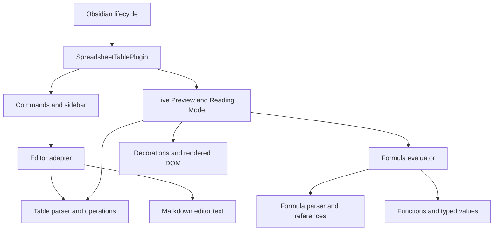

# Technical Documentation

This document describes the repository implementation of Spreadsheet Table `1.0.3`. Source and configuration are the authority; runtime compatibility and publication require separate evidence. See [README](README.md) for setup and usage.

## 1. System overview and evidence

Spreadsheet Table runs inside Obsidian. Markdown text is the table and formula source of truth. Synchronous TypeScript modules parse and evaluate tables; adapters apply editor edits or render calculated output. The only plugin-managed persistent configuration uses Obsidian's `loadData` and `saveData` APIs. There is no backend, database, authentication service, exchange-rate provider, or cloud synchronization implementation.

| Status | Evidence and scope |
| --- | --- |
| **Implemented** | `SpreadsheetTablePlugin.onload` registers settings, commands, view, ribbon, editor extension, Markdown postprocessor, DOM events and header synchronization |
| **Implemented, optional** | Formula rendering in both modes and Live Preview headers are settings-controlled |
| **Test-covered** | No checked-in automated tests, fixtures, test runner configuration or test script was found |
| **Verified in this task** | On 2026-11-01, `./node_modules/.bin/tsc --noEmit --skipLibCheck` and `npm run lint` exited successfully during documentation work |
| **Externally unverified** | Obsidian desktop/mobile runtime, compatibility with the declared minimum host, actual GitHub Actions/releases/attestations and Community Plugins listing |
| **Experimental / Inactive** | Dependency-highlight preference and related styling have no connected dependency-highlight renderer; some exported utilities have no runtime callers |
| **Planned / Not implemented** | Recommendations in section 15 are extension directions, not existing capabilities or committed roadmap items |

No build, automated tests, installation, or external-service validation was performed for this documentation task. Earlier session actions are not treated as validation of this documentation change.

## 2. Architecture and lifecycle

`src/main.ts` is the composition root. `SpreadsheetTablePlugin` loads settings, registers icons and commands, constructs `SpreadsheetTableSettingTab`, registers the `SpreadsheetToolbarView` factory, and passes settings getters into the Live Preview integration. Reading Mode receives current settings at postprocessor invocation. Dependencies are supplied through imports, constructor arguments, and callbacks; no dependency-injection framework is used.



The table and formula layers do not import Obsidian runtime APIs. Shared types contain an Obsidian `App` type import for `TableOperationContext`; type-only imports do not create a runtime host dependency. Editor, settings, UI and render adapters depend on the host. Source dependencies include formula normalization in the table parser, so the table/formula boundary is not completely independent.

Obsidian owns plugin registrations, workspace leaves and editor extensions. The ribbon reuses an existing toolbar leaf or requests a right leaf and sets its view state. The toolbar creates its buttons when opened. A body-wide `MutationObserver` schedules header synchronization, coalesced through `requestAnimationFrame`; a registered 1,500 ms interval also schedules it. Observer disconnection is registered with the plugin, and the host manages registered interval/event cleanup. There is no explicit cleanup for an already scheduled animation frame or a custom unload routine that removes every injected DOM node. Runtime unload behavior needs host validation.

## 3. Modules and responsibilities

| File or directory | Main interfaces and responsibilities |
| --- | --- |
| `src/main.ts` | `SpreadsheetTablePlugin`: composition, settings load/save, toolbar activation and table key handling |
| `src/types.ts` | `MarkdownTable`, `CellPosition`, `FormulaValue`, `EvaluationResult`, `TableEvaluation`, settings and defaults |
| `src/commands.ts` | Registers editor commands and the GitHub README help action |
| `src/settings.ts` | `SpreadsheetTableSettingTab`: settings controls and asynchronous persistence |
| `src/ui/toolbar.ts` | `SpreadsheetToolbarView`, action definitions, editor resolution and selection restoration |
| `src/ui/icons.ts` | Custom spreadsheet and sort icon registration |
| `src/table/parser.ts` | Table detection, escaped-pipe splitting, width normalization, formatting and source-position conversion |
| `src/table/format.ts` | Clone-based row/column changes, alignment, sorting and formatting wrapper |
| `src/table/editor.ts` | Active table lookup, editor replacements, cursor navigation, formula normalization helper and browser download |
| `src/table/csv.ts` | `tableToCsv`: raw cells to CSV with quote escaping |
| `src/formula/parser.ts` | Tokenizer, AST types, recursive-descent parser and formula-text normalization |
| `src/formula/references.ts` | Column-name conversion, A1 parsing, range expansion and result keys |
| `src/formula/values.ts` | Scalar construction, cell-value parsing, display, dates and currency resolution |
| `src/formula/functions.ts` | `applyBinary`, `FUNCTION_HANDLERS` and six built-in functions |
| `src/formula/evaluator.ts` | Table traversal, recursive references, circularity detection and dependency collection |
| `src/render/live-preview.ts` | CodeMirror decorations, widgets, selected cell state and optional DOM headers |
| `src/render/reading-mode.ts` | Source-section formula recovery and rendered table replacement |
| `styles.css` | Toolbar layout, formula/error output, selected cells and optional headers; some styles have no active consumer |
| `esbuild.config.mjs`, `tsconfig.json`, `eslint.config.mjs` | Bundle, TypeScript and lint configuration |
| `.github/workflows/release.yml` | Version-tag release pipeline |
| `docs/help.md`, `README.md`, `LICENSE` | Usage, developer entry point and project license |

`normalizeActiveFormulaCell`, `ensureTableShape`, `renderedRowsFromMarkdownLine`, and `positionToReference` are examples of exported helpers without callers in the current normal runtime path. Their existence does not imply automatic per-keystroke normalization, shape repair, or other UI features.

## 4. Data flows

### Editing and CSV output

1. Editor commands receive an Obsidian `Editor`. Toolbar actions resolve the most recent Markdown leaf or active Markdown view.
2. `getActiveTable` parses the table at the cursor. If needed, toolbar selection restoration finds a source table using saved start/end lines and moves the cursor to the selected cell.
3. Structural functions clone the table before modifying it. Formatting serializes the whole table; `Editor.replaceRange` replaces its source-line range.
4. Formula identifiers and references are uppercased during serialization, outside quoted strings. Row/column edits and sorting do not adjust formulas to preserve logical references.
5. CSV serializes headers and body using raw cell strings, joins rows with newlines, and quotes cells containing commas, quotes or line breaks. The editor adapter creates a Blob URL and temporary download anchor, clicks it, removes it and revokes the URL. It does not evaluate formulas or save through a vault API.

The keydown handler ignores already-handled and composing events. It handles Tab, Shift+Tab and Enter when the active Markdown editor cursor is within a parsed table. Navigation is bounded by the existing table; it does not append rows. Horizontal wrapping skips the alignment row, but the downward Enter path simply increments a line and can reach the alignment row from the header.

### Live Preview

The registered CodeMirror `StateField` builds decorations only when `editorLivePreviewField` is enabled. Creation and document/selection transactions rebuild by reading the entire document, finding tables, evaluating formulas, and replacing formula source ranges visually with `FormulaWidget` spans. Markdown storage remains unchanged. Settings are read through a callback; a settings change alone does not dispatch a recomputation transaction.

DOM header synchronization is a separate path. When enabled, it adds a letter row and row-number cells to matching Live Preview tables, excluding Reading Mode. Click handling stores the selected original row/column and source table boundaries, and applies selection styling. Mapping rendered tables to source uses their ordinal position, without a document identifier in stored selection. Dependency maps are not used for highlighting.

### Reading Mode

For each rendered table, `renderReadingMode` first captures DOM cell text. It requests `ctx.getSectionInfo(tableEl)`, scans the indicated lines in `section.text`, and matches tables by occurrence within identical section bounds. Source and rendered row/column dimensions must match.

Source formula cells replace the corresponding captured cell strings before evaluation; nonformula cells retain rendered text. A rendered string beginning with `=` whose source is not a formula is suppressed as an evaluation input. Each result replaces the cell content with a text span and a formula marker attribute. There is no Markdown-note write.

This source recovery preserves `*` operators that Markdown emphasis can remove from DOM text. For example, rendered text may turn `=722*2+621*2` into `=7222+6212`; the evaluator must receive the original expression. If section information, a source table, or matching dimensions are missing, this renderer leaves the table unchanged. The fallback prevents evaluation from damaged rendered text, but does not guarantee correct display in every embedding context or undo output from another processor.

### Persistence and external navigation

Settings controls update the in-memory settings object and await `saveData`. Note persistence belongs to Obsidian's editor. Help uses `activeWindow.open` with the repository README URL. No request pipeline, streaming, remote analysis, retry loop or provider adapter exists.

## 5. Data models and state

`MarkdownTable` stores zero-based source start/end lines, header cells, alignment values, body rows and raw source lines. Parsed rows are padded to the maximum observed width. Alignment values are `left`, `center`, or `right`.

`CellPosition` uses zero-based row/column indexes. Formula evaluation treats `[headers, ...rows]` as its grid, so `A1` is the header. Editor cursor helpers also work with physical table-line offsets that include the alignment row; these conventions must not be interchanged.

`FormulaValue` is a tagged scalar (`number`, `date`, `text`, `blank`, `error`) with a `number | string | Date | null` payload, optional currency and optional error string. `EvaluationResult` adds display text and dependency positions. `TableEvaluation` stores results and dependencies in maps keyed as `row:col`.

Each `evaluateTable` call creates fresh maps. Previously completed cells in that traversal may be reused; recursively evaluated forward references are not independently cached until reached by the outer traversal. Dependency positions are deduplicated by key. Cache hits do not reconstruct a complete transitive dependency graph. There is no persisted calculation cache, AST cache, incremental invalidation graph or database schema.

Selection is a module-level `LivePreviewCellSelection | null`, with line bounds and coordinates but no file/view identity. Settings are host-managed plugin data, with defaults merged using `Object.assign`. A legacy `showCellLabelsInLivePreview` preference populates `showHeadersInLivePreview` only if the new preference is absent. There is no schema version or comprehensive validation of loaded settings. Cloud, sync, filesystem encryption and conflict resolution belong to the host/vault configuration, not this plugin.

## 6. Parsing, algorithms and formula semantics

### Markdown tables

Detection requires pipe-prefixed contiguous lines and an alignment line immediately after the header. Alignment cells must match at least three hyphens with optional edge colons. The parser splits unescaped pipes, retaining backslashes. It does not implement a full Markdown syntax tree, fenced-code exclusion, nested table contexts or blockquote/callout parsing. Cursor positioning uses simpler pipe scans than the row parser, so escaped delimiters need care.

Formatting computes widths, pads cells according to alignment and normalizes formula text. Sorting compares comma-stripped finite numbers numerically; otherwise it uses locale-aware comparison with numeric ordering and base sensitivity. Sorting uses raw cell text, not evaluated values.

### Formula grammar

`parseFormulaExpression` strips a leading `=` and tokenizes decimal numbers, quoted strings, references, identifiers, four operators, parentheses, commas and colons. Recursive-descent layers give `*` and `/` priority over `+` and `-`; each level is left-associative. Parentheses override grouping.

References and function names are case-insensitive. There are no unary AST nodes: leading signs and expressions such as `=-2` or `=2*-3` fail even though signed numbers in ordinary cells are accepted. Formula numeric literals have no exponent, thousands separator or leading-dot form. Quoted strings end at the next matching quote; the tokenizer does not implement escaped quotes, while the normalization helper skips backslash escapes. No JavaScript `eval` or dynamic code execution is used.

A1 references support multi-letter columns. Rectangular ranges expand inclusively in normalized row/column order. Whole-column ranges iterate all current rows, including the header. Out-of-grid references read an empty string and become blank values rather than necessarily producing `#REF!`. Range sizes and recursion depth have no explicit limits.

### Evaluation and built-ins

A per-evaluation `visiting` set detects recursive cell access. Binary operations propagate error operands; numeric operands otherwise require number types, with special date arithmetic described below. A standalone range is aggregated to a sum, ignoring nonnumeric values but propagating a contained error. Function arguments flatten ranges before invoking handlers.

| Function | Current behavior |
| --- | --- |
| `SUM` | Sums numeric arguments, returns zero if none; nonnumbers, including errors, are filtered out |
| `AVERAGE` | Averages numeric arguments; returns blank if none; nonnumbers, including errors, are filtered out |
| `CONVERT` | Multiplies numeric value and supplied numeric rate; optional text currency labels the result; a direct third-argument cell reference uses that cell's raw text |
| `DATE` | Requires numeric year/month/day and validates the constructed calendar date through the date parser; invalid input returns `#VALUE!` |
| `TODAY` | Returns the current local calendar date at evaluation time; arguments are not explicitly rejected |
| `DAYS` | Returns rounded local-midnight millisecond difference divided by 86,400,000 for two date values |

Functions generally select needed arguments rather than enforcing exact arity. `SUM`/`AVERAGE` error filtering differs from range aggregation and binary error propagation. Whole-column formulas that include themselves encounter circularity, but aggregating functions can filter that error; they should not be presented as safe total formulas.

### Numbers, currency and dates

Ordinary cell parsing trims text, treats empty/`-` as blank, tries dates, then currency-prefixed numbers, and otherwise produces text. Numeric parsing removes commas and requires a signed digit/comma sequence with optional decimal digits; comma placement is not strictly validated. Display uses JavaScript `Number.toFixed`, configurable grouping and decimal separators, and an optional prefix. It does not provide decimal financial arithmetic, overflow guards or locale-dependent input parsing.

Currency extraction recognizes the prefixes listed in the README case-insensitively but retains the matching input spelling. Currency unification compares stored strings; aliases and casing are not normalized. Multiple distinct prefixes produce `#CURRENCY!`. A single prefix is preserved even for multiplication and division, without dimensional currency analysis. `CONVERT` is a local multiplication and label operation, with no official or unofficial exchange-rate endpoint.

Dates accept year-first hyphen/slash or day-first slash syntax and reject calendar rollovers. Local JavaScript `Date` values are stripped to midnight. A date on the left can add/subtract numeric days, and subtracting two dates yields day difference; number-plus-date is not handled symmetrically. `TODAY` uses the host timezone and has no midnight refresh timer. DST behavior follows local date arithmetic and rounded day differences, not a timezone-independent calendar library.

## 7. External dependencies and build boundaries

All root dependencies are declared as development dependencies. The lockfile is authoritative for reproducible installation; it contains registry resolutions and platform-specific optional esbuild packages. The root declares no `engines` or `packageManager` pin.

| Package | Declared | Locked | Purpose |
| --- | --- | --- | --- |
| `obsidian` | `^1.8.7` | `1.13.1` | Host API typings/development package; runtime API is supplied by Obsidian |
| `@codemirror/state` | `6.5.0` | `6.5.0` | Editor state and range sets; externalized in bundle |
| `@codemirror/view` | `6.38.6` | `6.38.6` | Decorations, widgets and DOM-to-editor mapping; externalized |
| `typescript` | `^5.8.3` | `5.9.3` | Typechecking |
| `esbuild` | `^0.25.5` | `0.25.12` | Bundling and watch mode |
| `eslint` | `^9.30.0` | `9.39.4` | Source lint |
| `@eslint/js` | `^9.30.0` | `9.39.4` | Recommended JavaScript lint configuration |
| `typescript-eslint` | `^8.35.0` | `8.62.1` | TypeScript lint configuration |
| `@types/node` | `^22.15.34` | `22.20.0` | Development Node.js type declarations |

There are no provider SDKs or remote data adapters. Obsidian's public API and CodeMirror imports are host integrations; DOM selectors and Obsidian-specific DOM helpers additionally couple rendering to host structure. They are not remote API endpoints. Runtime imports are supplied by Obsidian rather than installed separately into each vault plugin directory.

`esbuild.config.mjs` externalizes Obsidian, Electron, Node built-ins, CodeMirror autocomplete/collab/commands/language/lint/search/state/view, and Lezer common/highlight/lr. An external name in this list does not establish that source actually uses that library or any corresponding feature.

Third-party licenses remain separate from the project-wide MIT [LICENSE](LICENSE). No third-party license audit was performed in this task.

## 8. Configuration and runtime modes

`manifest.json` declares plugin ID `spreadsheet-table`, version `1.0.3`, minimum Obsidian `1.5.0` and `isDesktopOnly: false`. No minimum OS versions, entitlements, signing settings, schemes, certificates, environment examples or API secrets are configured. The manifest's compatibility claim has not been runtime-validated here.

| Setting | Default | Effect |
| --- | --- | --- |
| `showHeadersInLivePreview` | `false` | Adds Live Preview column letters and row numbers through DOM synchronization |
| `decimalPlaces` | `2` | Result precision; settings UI offers 0–15 |
| `groupingSeparator` | `,` | Output grouping; empty UI input falls back to default |
| `decimalSeparator` | `.` | Output decimal separator; empty UI input falls back to default |
| `enableDependencyHighlight` | `true` | Saved preference only; **Experimental / Inactive** renderer integration |
| `enableFormulaRenderingInLivePreview` | `true` | Enables CodeMirror formula decorations |
| `enableFormulaRenderingInReadingMode` | `true` | Enables the Markdown table postprocessor |

TypeScript uses ESNext modules, ES2022 target/libraries, DOM types, Node resolution, isolated modules, `noImplicitAny` and `strictNullChecks`. The production bundler emits CommonJS targeting ES2018 with minification and no source maps. `npm run dev` uses watch mode and inline source maps; it does not typecheck. Only an exact `production` command argument selects one-shot production output. No automatic vault-copy or reload step exists.

ESLint uses flat configuration with recommended JavaScript and TypeScript rules, project-service parsing, disabled explicit-any enforcement, and underscore exceptions for unused names. There are no dedicated formatter or test configurations.

## 9. Error handling, logging and recovery

| Error or condition | Handling |
| --- | --- |
| Formula parser/evaluation exception | `evaluateFormulaCell` catches it and returns `#ERROR!` |
| Recursive access | `#CIRC!` from the visiting set; enclosing aggregators may filter errors |
| Unknown function | `#NAME?` |
| Invalid reference conversion | `#REF!`; syntactically valid out-of-grid references instead become blanks |
| Invalid operand or function argument | `#VALUE!` |
| Numeric division by zero | `#DIV/0!` |
| Mixed stored currency labels | `#CURRENCY!` |
| Missing editor/table/selection | Obsidian `Notice`, false return, or no operation depending on caller |
| Failed Live Preview table decoration | Per-table catch skips it without diagnostics |
| Missing Reading Mode source/dimension match | Skips replacement without evaluating rendered formula text |

Error results receive error styling; there is no structured logging, telemetry, redaction layer, retry/backoff, rate limiting or user-visible trace. Settings persistence and asynchronous toolbar calls do not have dedicated recovery/cancellation handlers. Browser CSV initiation produces a success Notice without confirming that the host actually saved a file. Input size, call depth and memory use are not bounded. Work is predominantly synchronous; there is no background worker or stale asynchronous formula-result protocol.

## 10. Security and privacy

Formulas are parsed into a restricted AST and dispatched to fixed handlers, rather than evaluated as code. Formula output is written through text APIs. No source path implements network data fetching, token storage, authentication, Keychain access, App Attest, APNs, TLS pinning, WebView embedding or a custom database. These are absent features, not security guarantees supplied by this plugin.

The plugin reads note/editor content, changes table source on user commands, observes the active document body, saves settings through Obsidian, and initiates CSV downloads. Help opens a fixed HTTPS GitHub README URL. There is no plugin-specific permission prompt or sandbox implemented in the source. Host permissions, vault encryption, sync transport, backups and conflict handling remain external to the repository. Cloud-synced vault deployment is ordinary file installation, with no sync protocol or convergence validation in this code.

CSV exports preserve raw formula text and do not implement spreadsheet formula-injection neutralization. Consider that boundary when opening exported user-supplied content in other spreadsheet software. There are no application secret files or credential requirements documented for local use. Release automation uses GitHub's injected workflow token; no token value belongs in documentation or source.

## 11. Build, CI and release

See the README for local commands. `npm run build` runs `tsc -noEmit -skipLibCheck` followed by `node esbuild.config.mjs production`. `main.js`, maps and `node_modules` are ignored by Git. The runtime installation consists of `main.js`, `manifest.json`, and `styles.css`; bundling alone does not deploy those files.

The `Release` workflow triggers on pushed tags matching `*.*.*`, runs on `ubuntu-latest`, uses checkout/setup-node v4 with Node.js 22 and npm caching, and performs `npm ci`. It strips an optional `v` prefix from the tag and compares it to `manifest.json` version. It does not compare the package version or synchronize versions automatically.

The workflow then lints, builds, invokes `actions/attest-build-provenance@v2` for the three runtime files, and uses `gh release create` to publish them with generated notes. Permissions include contents, id-token and attestations write. `GH_TOKEN` is populated from the GitHub workflow token. These are configured actions, not proof of successful execution, attestation issuance, release availability or plugin-directory acceptance. No push/PR validation workflow or test step is configured. This documentation task did not trigger or inspect a remote release.

## 12. Testing and task validation

No checked-in test framework, unit/integration/UI tests, fixture suite, or `npm test` script exists. No feature is labeled **Test-covered** on the strength of source code, example tables or CI configuration alone. The repository does not provide a reproducible automated Obsidian UI harness.

For this documentation task, the installed local toolchain successfully ran:

```bash
./node_modules/.bin/tsc --noEmit --skipLibCheck
npm run lint
```

These verify source type compatibility and configured lint rules; they do not prove formula correctness, runtime behavior, platform compatibility or release success. No dependency installation or build was needed. Document checks cover local links/paths, fenced blocks, command and configuration consistency, sensitive-value patterns, whitespace and a final Git change-scope check.

Recommended manual checks, **not executed in this task**, include installing the built assets in a test vault, exercising table commands and source-mode navigation, checking Live Preview/Reading Mode arithmetic and references, toggling settings, reloading the plugin, and testing CSV download on each intended platform. Formula checks should include precedence (`=722*2+621*2` → `2,686.00` with defaults), circularity, error filtering, whole columns, currency aliases and Markdown emphasis. These are proposed checks, not a test suite.

## 13. Known limitations and technical debt

- The evaluator is a simplified spreadsheet model: no absolute/cross-table references, comparisons, exponentiation, unary signs, expression-level locale parsing, Excel import/export, or Advanced Tables directives.
- Structural changes keep literal formula references unchanged. Sort order uses raw text. These behaviors can change a formula's meaning relative to moved data.
- Whole-document parsing on selection changes, repeated splitting/scanning and range-array expansion can scale poorly. There is no calculation budget, explicit range cap, recursion cap or worker offloading.
- Dependency metadata is incomplete for transitive cache hits, and the saved highlight setting has no renderer consumer. It must not be advertised as implemented highlighting.
- DOM ordinal mapping, body observation, a module-global selection and active-document helpers create coupling to host rendering, partial rendering and multi-window behavior. Mobile CSS and the manifest flag do not validate those cases.
- The downward navigation path can land on the separator after a header. Simple cursor pipe scans are less robust than escaped-pipe row splitting.
- Reading Mode relies on host section text/line semantics, occurrence ordering and equal dimensions; unsupported contexts are skipped. Ordinary formatted values use DOM text in Reading Mode but source text in Live Preview, which can produce mode differences.
- Formula string tokenization and normalization disagree on escaped quotes. Function arity and loaded settings are weakly validated; arithmetic has no finite-result guard.
- Local dates, DST rounding, lack of midnight refresh and missing settings-only decoration invalidation should be considered when debugging stale output.
- Minimum Obsidian version is older than the locked development API. No compatibility matrix or automated runtime suite substantiates that declared floor.
- Some helper exports and CSS classes are unused; no dedicated migration/version schema, structured diagnostics or third-party license audit is supplied.

## 14. Design decisions and trade-offs

These decisions are inferred from code structure, rather than an independent architectural decision record:

- Plain Markdown storage keeps formulas portable as text and avoids a proprietary table store. Display is derived and may depend on host rendering.
- Parsing to a fixed AST constrains expression execution and centralizes supported operators/functions. It intentionally provides a much smaller language than Excel.
- Clone-based structural operations isolate transformations from editor replacement. Full-table serialization can alter spacing and does not solve reference adjustment.
- Separate rendering adapters share one evaluator but obtain cells differently: raw editor text for Live Preview and source formulas plus rendered ordinary text for Reading Mode.
- Reading Mode skips unresolvable source contexts instead of calculating from potentially stripped DOM text. This conservative behavior trades display coverage for avoiding a known wrong-input calculation path.
- Local conversion rates avoid provider credentials and requests but require users to supply and maintain rates.
- Host-owned settings and lifecycle registration reduce infrastructure, while leaving permission, persistence, sync and compatibility boundaries with Obsidian.

## 15. Future development — recommended, not implemented

| Extension point | Recommended direction and boundaries |
| --- | --- |
| `src/formula/` | Add deterministic parser/evaluator tests, explicit grammar additions, bounded ranges and recursion; preserve AST dispatch without dynamic code execution |
| `TableEvaluation` and render adapters | Define complete dependency semantics before implementing incremental recalculation or dependency highlighting |
| `src/table/format.ts` and editor adapter | Add reference-aware structural edits with tested coordinate conversions; keep transformations separate from host mutations |
| Reading Mode and DOM selection mapping | Add host integration tests for sections, embeds, multiple tables and view identity before expanding fallback behavior |
| Settings load/save | Introduce validated, versioned settings and an explicit render-refresh mechanism while preserving the existing legacy-key migration |
| `src/table/csv.ts` | Define optional safe-export behavior for formulas and verify downloads across hosts without silently changing raw export semantics |
| CI and documentation | Add offline automated checks and a host-version/platform matrix before claiming test coverage or broader runtime compatibility |

No remote provider interface currently exists. Any future rate service would need a separate data boundary, credential policy and failure model; it must not be implied by the present `CONVERT` handler or introduced as part of documentation maintenance.
